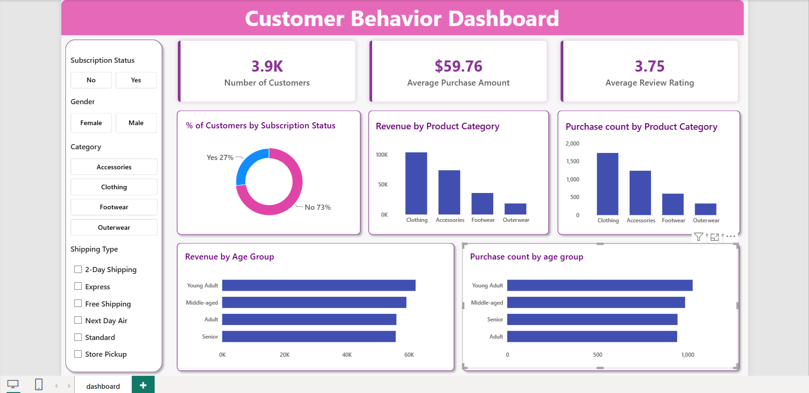

# Customer Shopping Behavior Analysis

An end-to-end data analytics project using **Python, MySQL, and Power BI** to analyze customer shopping behavior, spending patterns, product preferences, and subscription trends.

## Project Overview

This project analyzes 3,900 customer purchase records to explore shopping patterns, customer segments, product performance, discount usage, and subscription behavior.

The project follows an end-to-end data analytics workflow, including data cleaning and exploratory data analysis in Python, business analysis using MySQL, and interactive dashboard development in Power BI.

## Objectives

* Analyze customer spending patterns across different demographics.
* Compare revenue generated by male and female customers.
* Identify top-rated and frequently purchased products.
* Evaluate discount usage and its relationship with purchase amounts.
* Analyze subscription behavior and customer loyalty.
* Segment customers based on their previous purchase history.
* Build an interactive Power BI dashboard to visualize key business metrics.

## Tools & Technologies

| Tool     | Purpose                                                     |
| -------- | ----------------------------------------------------------- |
| Python   | Data cleaning, preprocessing, and exploratory data analysis |
| Pandas   | Data manipulation and transformation                        |                                      
| MySQL    | Data querying and business analysis                         |
| Power BI | Interactive dashboard and data visualization                |

## Dataset Overview

* **Total Records:** 3,900
* **Original Columns:** 18
* **Missing Values:** 37 in the `review_rating` column

### Key Features

* **Customer Demographics:** Age, Gender, Location, Subscription Status
* **Purchase Details:** Item Purchased, Category, Purchase Amount, Season, Size, Color
* **Shopping Behavior:** Discount Applied, Promo Code Used, Previous Purchases, Frequency of Purchases, Review Rating, Shipping Type

## Project Workflow

### 1. Data Cleaning & Exploratory Data Analysis (Python)

Performed data preparation and exploratory analysis using Pandas.

* Loaded and inspected the dataset using `info()`, `describe()`, and other Pandas functions.
* Identified and handled missing values.
* Imputed missing review ratings using the median rating of the corresponding product category.
* Created an `age_group` column by grouping customer ages.
* Created a `purchase_frequency_days` column based on purchase frequency.
* Checked for redundancy between `discount_applied` and `promo_code_used` and removed the redundant column.
* Exported the cleaned dataset to CSV format.
* Connected Python to MySQL and loaded the cleaned data into the database for further analysis.

### 2. SQL Business Analysis (MySQL)

Performed business analysis using MySQL to explore customer behavior and purchasing patterns.

**Key analyses:**

1. **Gender-wise Revenue Analysis** – Compared total revenue generated by male and female customers.
2. **High-Spending Discount Users** – Identified customers who used discounts but spent more than the average purchase amount.
3. **Top 5 Products by Average Review Rating** – Identified products with the highest average review ratings.
4. **Shipping Type Comparison** – Compared average purchase amounts for Standard and Express shipping.
5. **Subscription Analysis** – Compared customer counts, average spending, and total revenue between subscribers and non-subscribers.
6. **Discount Usage by Product** – Identified the five products with the highest percentage of discounted purchases.
7. **Customer Segmentation** – Classified customers into New, Returning, and Loyal segments based on previous purchases.
8. **Top 3 Products by Category** – Identified the three most purchased products within each category.
9. **Repeat Buyers and Subscription Analysis** – Examined subscription status among customers with more than five previous purchases.
10. **Age Group-wise Revenue Analysis** – Analyzed revenue contribution across different age groups.

**SQL concepts used:**

* Aggregate functions (`SUM`, `AVG`, `COUNT`)
* `GROUP BY` and `HAVING`
* Conditional aggregation using `CASE`
* Subqueries
* Common Table Expressions (CTEs)
* Window functions (`ROW_NUMBER`)
* Sorting and filtering

### 3. Interactive Dashboard (Power BI)

Developed an interactive Power BI dashboard to visualize customer shopping behavior and key performance indicators.

**Key metrics:**

* Number of Customers
* Average Purchase Amount
* Average Review Rating

**Visualizations:**

* Customer distribution by subscription status
* Revenue by product category
* Purchase count by product category
* Revenue by age group
* Purchase count by age group

**Interactive filters:**

* Subscription Status
* Gender
* Category
* Shipping Type

The dashboard allows users to explore customer behavior across different categories and demographic groups using interactive slicers.

## Dashboard Preview



## Business Recommendations

Based on the analysis, the following potential business actions were identified:

* **Subscription Growth:** Promote relevant subscription benefits to encourage customer sign-ups.
* **Customer Loyalty:** Consider loyalty programs and rewards for repeat customers.
* **Discount Strategy:** Review discount usage to balance customer engagement with profitability.
* **Product Promotion:** Use highly rated and frequently purchased products to inform marketing campaigns.
* **Targeted Marketing:** Use age-group and shipping-related purchasing patterns to inform marketing strategies.


## Project Structure

```text
customer_trends_analysis/
│
├── data/
│   ├── raw/
│   │   └── customer_shopping_behavior.csv
│   │
│   └── processed/
│       └── customer_data_cleaned.csv
│
├── python/
│   └── customer_shopping_behavior_analysis.ipynb
│
├── sql/
│   ├── create_database.sql
│   └── business_analysis.sql
│
├── powerbi/
│   ├── customer_behavior_dashboard.pbix
│   └── dashboard.png
│
├── requirements.txt
├── .gitignore
└── README.md
```

## How to Run the Project

### 1. Clone the Repository

```bash
git clone https://github.com/PriyaShrivastava25/customer_trends_analysis.git
cd customer_trends_analysis
```

### 2. Set Up Python Environment

```bash
python -m venv .venv
```

Activate the environment on Windows:

```bash
.venv\Scripts\activate
```

Install the required libraries:

```bash
pip install -r requirements.txt
```

### 3. Run Python Analysis

Open the Jupyter Notebook in the `python` folder and run the cells to perform data cleaning, preprocessing, and exploratory data analysis.

Update the dataset path if required.

### 4. MySQL Analysis

* Create the project database in MySQL.
* Configure your MySQL connection in Python.
* Load the cleaned dataset into MySQL.
* Execute the SQL queries in MySQL Workbench to perform business analysis.

### 5. Power BI Dashboard

Open the `.pbix` file in Power BI Desktop. Configure the data source if necessary and refresh the data to explore the interactive dashboard.

## Author

**Priya Shrivastava**

### Connect with Me

- **GitHub:** [PriyaShrivastava25](https://github.com/PriyaShrivastava25)
- **LinkedIn:** [Priya Shrivastava](https://www.linkedin.com/in/priya-shrivastava-2502501ba)
